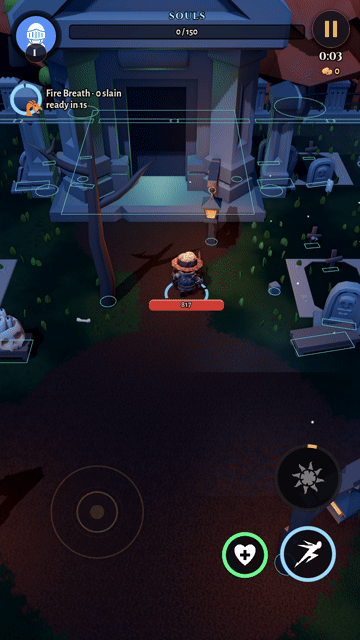
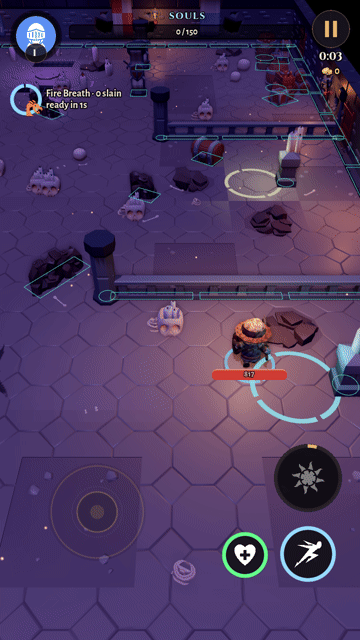
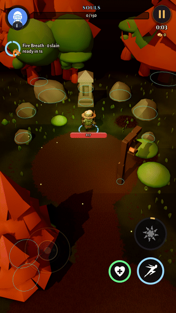

# Prop collision review

Bug: heroes and monsters walked through buildings, for example the graveyard crypt.

## How it works now
- `src/hunt/prop_shapes.gd` gives every model an entry in `POLICY`: **box** (oriented rectangle), **round** (circle) or **walk** (no collider). `OVERRIDE` corrects models whose footprint reads wrong, such as tree crowns and post arms.
- Sizes come from each mesh's footprint between 0.25 m and 1.6 m up, so canopies and steps don't count. They are baked to `src/data/prop_footprints.gd` and then scaled per placed instance. Anything under 0.45 m across once placed stays walkable.
- `Arena.put()` registers the shape with the same 2D obstacle grid the hero, enemies, allies, sidekicks, projectiles, the bot and the flow field already use. That means routing needs no extra system. Boxes are one extra rotate-and-clamp test behind a bounding-circle early-out, which keeps it cheap on mobile. Props raised off the floor or outside the arena bounds are skipped.
- Rebake after adding or changing models: `tools/dev/godot.sh res://tools/dev/bake_prop_footprints.tscn` (takes about 3 minutes).
- Debug view: `Arena.debug_outlines()` draws every collider (the cyan outlines in the captures).

## Tests (`src/tests.gd`, `_collision_tests`)
- Every model placed in barrow, depths, vault, grove and trial (seeds 1–3) has a policy.
- Every placed blocking prop has a collider, and ground clutter has none.
- Every blocking type has a baked footprint, and the crypt's footprint matches its mesh.
- The hero can't enter the crypt from 11 directions, and projectiles stop at it.
- A foe paths around the crypt to the hero through the flow field.

## Captures (`--capture --shots=collision --zone=barrow|depths|grove`)
| zone | building | result |
|---|---|---|
| barrow | crypt | Hero pushed north stops at the crypt front (z -19.0). The brute walks around the crypt corner to the hero and never enters the box. |
| depths | barrier wall | Hero stops at z 4.73 against the barrier. The brute routes around it and reaches the hero in 10.8 s. |
| grove | shrine | Hero slides around the shrine. The minion routes around it and reaches the hero in 3.1 s. |

  

Top-down collider maps: `coll_*_map.png`.

## Every prop type (114)
| model | status | notes |
|---|---|---|
| `crypt.gltf` | box | oriented box ±5.2×±7.0 m at its placed 1.9 scale (was 4 hand-placed circles) |
| `arch_gate.gltf` | box | oriented box |
| `wall.gltf` | box | oriented box |
| `wall_arched.gltf` | box | oriented box |
| `wall_broken.gltf` | box | oriented box |
| `wall_cracked.gltf` | box | oriented box |
| `wall_window_closed.gltf` | box | oriented box |
| `fence.gltf` | box | oriented box |
| `fence_broken.gltf` | box | oriented box |
| `barrier.gltf` | box | oriented box (replaced the manual 0.7 m circles in depths) |
| `coffin.gltf` | box | oriented box |
| `coffin_decorated.gltf` | box | oriented box |
| `bench.gltf` | box | oriented box |
| `bench_decorated.gltf` | box | oriented box |
| `grave_A.gltf` | box | oriented box |
| `grave_B.gltf` | box | oriented box |
| `grave_A_destroyed.gltf` | box | oriented box |
| `gravestone.gltf` | box | oriented box |
| `gravemarker_A.gltf` | box | oriented box |
| `gravemarker_B.gltf` | box | oriented box |
| `crates_stacked.gltf` | box | oriented box |
| `box_stacked.gltf` | box | oriented box |
| `barrel_small_stack.gltf` | box | oriented box |
| `chest.gltf` | box | oriented box |
| `chest_gold.gltf` | box | oriented box |
| `rubble_large.gltf` | box | oriented box |
| `rubble_half.gltf` | box | oriented box |
| `pillar_decorated.gltf` | box | oriented box |
| `tree_pine_orange_large.gltf` | round | circle |
| `tree_pine_yellow_large.gltf` | round | circle |
| `tree_pine_orange_medium.gltf` | round | circle |
| `tree_pine_yellow_medium.gltf` | round | circle |
| `tree_pine_orange_small.gltf` | round | circle |
| `tree_dead_large.gltf` | round | circle |
| `tree_dead_large_decorated.gltf` | round | circle |
| `tree_dead_medium.gltf` | round | circle |
| `Tree_1_A_Color1.gltf` | round | circle |
| `Tree_2_A_Color1.gltf` | round | circle |
| `Tree_3_A_Color1.gltf` | round | circle |
| `Tree_Bare_1_A_Color1.gltf` | round | circle |
| `Tree_Bare_2_A_Color1.gltf` | round | circle |
| `pillar.gltf` | round | circle |
| `column.gltf` | round | circle |
| `shrine.gltf` | round | circle |
| `shrine_candles.gltf` | round | circle |
| `barrel_large.gltf` | round | circle |
| `pumpkin_orange.gltf` | round | circle |
| `pumpkin_orange_jackolantern.gltf` | round | circle |
| `lantern_standing.gltf` | round | circle |
| `fence_pillar.gltf` | round | circle |
| `fence_pillar_broken.gltf` | round | circle |
| `post_lantern.gltf` | round | circle |
| `post_skull.gltf` | round | circle |
| `Rock_1_A_Color1.gltf` | round | circle |
| `Rock_1_B_Color1.gltf` | round | circle |
| `Rock_1_C_Color1.gltf` | round | circle |
| `Rock_1_D_Color1.gltf` | round | circle |
| `Rock_1_E_Color1.gltf` | round | circle |
| `Rock_1_F_Color1.gltf` | round | circle |
| `Rock_1_G_Color1.gltf` | round | circle |
| `Rock_1_H_Color1.gltf` | round | circle |
| `Rock_1_I_Color1.gltf` | round | circle |
| `Rock_1_J_Color1.gltf` | round | circle |
| `Rock_2_A_Color1.gltf` | round | circle policy, but has no body-band footprint (flat slab), so it is walkable in practice |
| `Rock_2_B_Color1.gltf` | round | circle |
| `Rock_2_C_Color1.gltf` | round | circle |
| `Rock_2_D_Color1.gltf` | round | circle |
| `Rock_2_E_Color1.gltf` | round | circle |
| `Rock_2_F_Color1.gltf` | round | circle |
| `Rock_2_G_Color1.gltf` | round | circle |
| `Rock_2_H_Color1.gltf` | round | circle |
| `Rock_3_A_Color1.gltf` | round | circle |
| `Rock_3_B_Color1.gltf` | round | circle |
| `Rock_3_C_Color1.gltf` | round | circle |
| `Rock_3_D_Color1.gltf` | round | circle |
| `Rock_3_E_Color1.gltf` | round | circle |
| `Rock_3_F_Color1.gltf` | round | circle |
| `Rock_3_G_Color1.gltf` | round | circle |
| `Rock_3_H_Color1.gltf` | round | circle |
| `Rock_3_I_Color1.gltf` | round | circle |
| `Rock_3_J_Color1.gltf` | round | circle |
| `bone_A.gltf` | walk | walkable: ground clutter |
| `bone_B.gltf` | walk | walkable: ground clutter |
| `bone_C.gltf` | walk | walkable: ground clutter |
| `skull.gltf` | walk | walkable: ground clutter |
| `ribcage.gltf` | walk | walkable: ground clutter |
| `skull_candle.gltf` | walk | walkable: ground clutter |
| `candle_lit.gltf` | walk | walkable: ground clutter |
| `candle_melted.gltf` | walk | walkable: ground clutter |
| `candle_triple.gltf` | walk | walkable: ground clutter |
| `coin.gltf` | walk | walkable: pickup-sized clutter |
| `coin_stack_small.gltf` | walk | walkable: pickup-sized clutter |
| `coin_stack_medium.gltf` | walk | walkable: pickup-sized clutter |
| `coin_stack_large.gltf` | walk | walkable: pickup-sized clutter |
| `floor_tile_extralarge_grates.gltf` | walk | walkable: floor tile, flat |
| `floor_dirt_grave.gltf` | walk | walkable: floor tile, flat |
| `banner_patternA_red.gltf` | walk | walkable: wall dressing, sits on a wall that already blocks |
| `banner_patternA_yellow.gltf` | walk | walkable: wall dressing, sits on a wall that already blocks |
| `banner_patternB_blue.gltf` | walk | walkable: wall dressing, sits on a wall that already blocks |
| `torch_mounted.gltf` | walk | walkable: wall dressing |
| `sword_shield_gold.gltf` | walk | walkable: wall dressing |
| `pumpkin_yellow_small.gltf` | walk | walkable: small ground clutter |
| `Bush_1_A_Color1.gltf` | walk | walkable: foliage, walkers brush through |
| `Bush_1_B_Color1.gltf` | walk | walkable: foliage, walkers brush through |
| `Bush_1_C_Color1.gltf` | walk | walkable: foliage, walkers brush through |
| `Bush_2_A_Color1.gltf` | walk | walkable: foliage, walkers brush through |
| `Bush_2_B_Color1.gltf` | walk | walkable: foliage, walkers brush through |
| `Bush_2_C_Color1.gltf` | walk | walkable: foliage, walkers brush through |
| `Bush_3_A_Color1.gltf` | walk | walkable: foliage, walkers brush through |
| `Bush_3_B_Color1.gltf` | walk | walkable: foliage, walkers brush through |
| `Bush_3_C_Color1.gltf` | walk | walkable: foliage, walkers brush through |
| `Bush_4_A_Color1.gltf` | walk | walkable: foliage, walkers brush through |
| `Bush_4_B_Color1.gltf` | walk | walkable: foliage, walkers brush through |
| `Bush_4_C_Color1.gltf` | walk | walkable: foliage, walkers brush through |

Unchanged: gates keep their manual circles (opening one disables it), and the trial dividers (multimesh) keep their manual circles.
